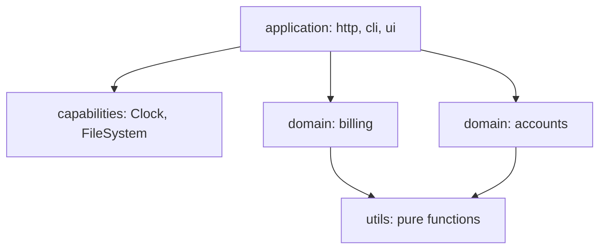

# Objects Where the Domain Lives

Most codebases contain three kinds of code and give all of them the same shape.

- Code that means something to the business. A subscription renews, an invoice is paid, a user changes an email.
- Code that means something about data. Trim a string, clamp a number, format a date.
- Code that touches the world. Read the clock, write a file, call the network.

Each kind has a different scope. Domain code is scoped to an object. Utilities have no scope at all. Unsafe code is scoped to the world. Matching the shape to the scope is most of the architecture.

So domain code becomes instance classes. Utilities become pure free functions. Unsafe code becomes a static class or a namespace. Not because OOP is superior to functional code. Because each shape contains exactly the amount of dirt that kind of code is allowed to have.

## Free functions get no scope

A free function has nowhere to put state, so it must not have any.

That is not a style preference. A dirty free function is a trap:

```ts
function addMonth(date: Date): Date {
  date.setMonth(date.getMonth() + 1)
  return date
}
```

Nothing in the signature says the date the caller passed in is now different. The function looks like a transformation. It is actually a mutation with an alibi.

The pure version returns a new value:

```ts
function addMonths(date: Date, count: number): Date {
  const next = new Date(date)
  next.setMonth(next.getMonth() + count)
  return next
}
```

Now the function has no scope to leak into. You can call it twice, reorder the calls, cache the result or run it in parallel and the program still means the same thing. That is what purity buys, and it is the only thing a free function can honestly sell.

This is why I keep utilities pure and generic: `clamp`, `slugify`, `addMonths`. Inputs in, value out. No `this`, no clock, no global config.

It is also why `StringUtils` is a function in a costume. A class with no fields, a private constructor and twelve static methods guards no invariant. The class part is decoration. If every method is static and there is nothing to construct, you wrote a namespace, and the language already has modules for that.

## Instance methods get the instance

The opposite mistake is more expensive. It looks like this:

```ts
interface SubscriptionRecord {
  id: SubscriptionId
  plan: Plan
  status: "trial" | "active" | "past_due" | "canceled"
  paidUntil: Date | null
}

function renew(record: SubscriptionRecord, now: Date, payment: Payment): void {
  if (record.status === "canceled") throw new Error("Canceled subscription cannot renew")
  if (!payment.covers(record.plan.price)) throw new Error("Payment does not cover the plan")

  record.paidUntil = addMonths(now, record.plan.period)
  record.status = "active"
}
```

This works until someone writes the second function. Then the third. Each one repeats the checks or forgets them, and the type system permits every state the rule was supposed to prevent. `status: "active"` with `paidUntil: null` is a legal value. `status: "canceled"` with a fresh `paidUntil` is legal too.

Nothing stops a handler from assigning `record.status = "active"` after a failed payment, because the record has no door to close. You cannot enforce a rule at a boundary that does not exist.

The same domain as a class:

```ts
type Status = "trial" | "active" | "past_due" | "canceled"

class Subscription {
  readonly id: SubscriptionId
  readonly plan: Plan
  #status: Status = "trial"
  #paidUntil: Date | null = null

  private constructor(id: SubscriptionId, plan: Plan) {
    this.id = id
    this.plan = plan
  }

  static start(id: SubscriptionId, plan: Plan): Subscription {
    return new Subscription(id, plan)
  }

  renew(now: Date, payment: Payment): void {
    if (this.#status === "canceled") throw new Error("Canceled subscription cannot renew")
    if (!payment.covers(this.plan.price)) throw new Error("Payment does not cover the plan")

    this.#paidUntil = addMonths(now, this.plan.period)
    this.#status = "active"
  }

  isActive(now: Date): boolean {
    return this.#status === "active" && this.#paidUntil != null && this.#paidUntil > now
  }
}
```

The class is allowed to be dirty. `renew` changes `#status` and `#paidUntil`, and that is the point. The mutation is scoped to the object the caller already holds. A dirty free function surprises you. A dirty method is what methods are for.

Queries work the same way. `isActive(now)` does not mutate anything, but it reads `this`. It belongs on the class because it is a question about the instance. The definition of "active" changes with the business, not with the caller.

Encapsulation is not about hiding fields for tidiness. It is about making the set of reachable states smaller than the set of representable states, and keeping every transition inside one file.

## Unsafe code gets a namespace

Some operations cannot be pure. The clock moves, the disk fails, the network lies. You cannot compute `now` from arguments.

These operations need a name, but they must not be free functions:

```ts
import { readFileSync } from "node:fs"

namespace Clock {
  export function now(): Date {
    return new Date()
  }
}

namespace FileSystem {
  export function read(path: string): string {
    return readFileSync(path, "utf8")
  }
}
```

Why not free functions? `now()` takes no arguments and returns a different value on every call, so it reads like a constant and behaves like a generator. `read(path)` looks like a lookup and performs I/O. The namespace is the warning label. `Clock.now()` tells the reader that the result is not a function of the arguments.

Why not instances? There is nothing to hold. An instance of `Clock` would have no state and no invariant, which is the `StringUtils` problem again. A static class or a namespace says "operations, no instances." A static class works in every runtime. A namespace states it more directly. I use whichever the codebase already uses.

One rule keeps namespaces honest: they must not hold mutable module state. If the capability needs state between calls, a connection pool or a buffer, it is an instance class. It still lives at the edge, next to the application, not in the domain. A namespace with a mutable variable is just a singleton in disguise.

## The boundary is where they meet

```ts
function handleRenewal(id: SubscriptionId, payment: Payment): void {
  const subscription = subscriptions.get(id)
  subscription.renew(Clock.now(), payment)
  subscriptions.save(subscription)
}
```

The handler knows the time and the repository. The subscription does not. `renew` is dirty, because it changes `this`, but it is world-pure, because time arrives as an argument. The unsafe calls stay in the handler, the one layer allowed to be unsafe.

That is why `renew` takes `now` instead of calling `Clock.now()` itself. The moment a domain method reads the clock, it becomes unsafe and the signature no longer says so. Passing the value in keeps the domain testable, keeps the namespace honest and keeps the arrow between layers pointing one way.

## The test I use

Three questions, in this order:

1. **Does it touch the world?** Clock, random, files, network, global state. Then it goes in a namespace, and the namespace does not know any domain.
2. **Does it mention a domain noun or need instance state?** Then it is a class. Construction goes through a constructor or a named factory. Behavior goes through an instance method, whether it mutates or not.
3. **Is it pure, total and generic?** Then it is a free function.

Purity alone does not make a utility. `plan.prorate(daysUsed)` is pure, and it is still domain code, because it speaks plans and money. Vocabulary decides the kind, then scope decides the shape.

## The dependency graph



The arrow means "depends on". Domains never point at capabilities. If a domain class needs a value from the world, the value comes in as an argument. That is the same boundary rule as [Code Boundaries](code-boundaries.md), applied one level down.

A namespace that imports a domain type has already moved out of the edge and into the domain. At that point it should be a method on that type.

## What makes a utility worth keeping

A function earns the right to be a free-floating utility when it is:

- **Pure.** Same input, same output, no ambient time, no global config, no hidden cache.
- **Total.** Defined for every value of its parameter types, or explicit about the one case it rejects.
- **Narrow.** One name, one job. `formatDate` does not also parse, sort and localize.
- **Domain free.** It knows strings, numbers, arrays and dates. It does not know customers.
- **Stable.** If it changes every sprint, its callers are not using a utility, they are using a shared assumption that keeps moving.

When a function fails any of these, I do not force it into a class. I first ask what it is missing: a scope, an owner or a name.

## Where I break my own rule

Static factories on domain classes are fine. `Money.of(amount, currency)` and `Subscription.start(id, plan)` construct an instance and can validate the arguments, so they are not utilities. The class still owns the invariant. The factory only gives the entry point a name.

Presentation is the other exception. `formatMoney(money)` belongs in the UI layer, not on `Money`. Formatting is a presentation concern, and the domain should not know about locale, currency symbols or view models. It takes a domain value as input. That is fine. Utilities may consume domain values; they just must not become part of the domain.

And bootstrap code can be unsafe everywhere. `main` is the edge. It is allowed to read the clock, open the database and wire everything together, because that is its entire job.

Everything else keeps its shape.

## The short version

If it has no scope, it must be pure. If it has object scope, it gets a class. If it has world scope, it gets a namespace. The boundary is the only place domain classes and namespaces meet.

Utilities are where behavior is stable, so they get a wide door. The domain is where the rules change, so it gets walls. The world is where nothing is stable, so it gets a name and a short leash.
